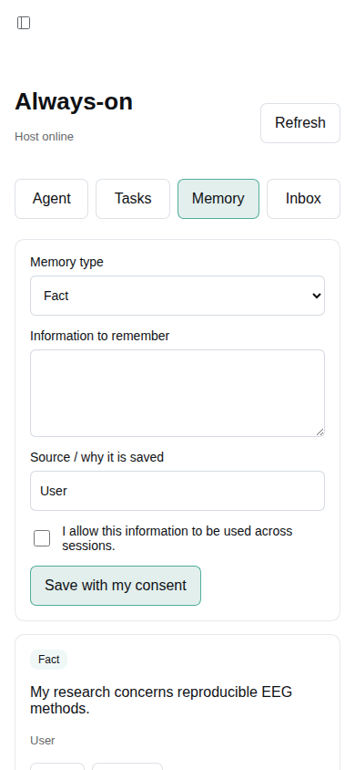
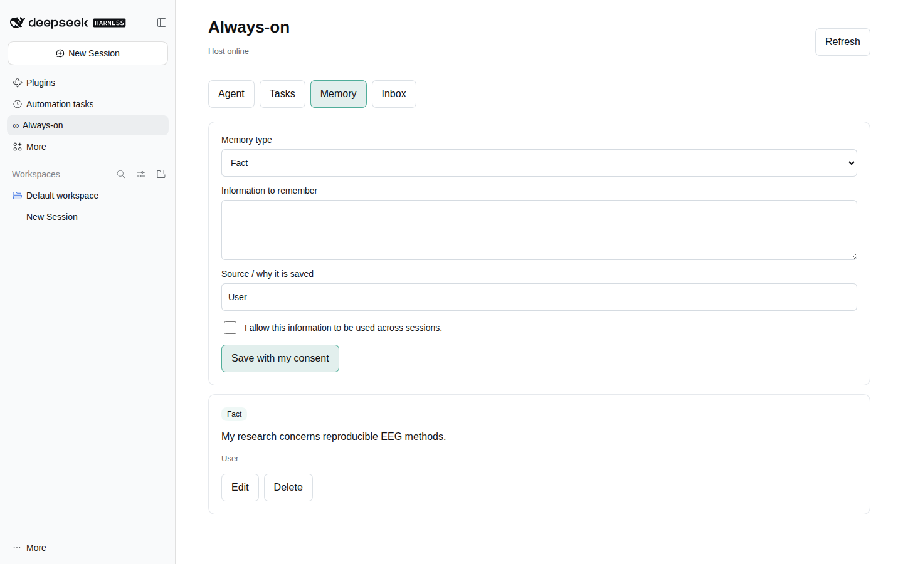

# Acceptance evidence

Status: **alpha — not MVP Ready**. This file defines claims; current GitHub Actions logs are the source for actual pass/fail status at a specific commit.

| Requirement | Automated coverage | Real-world gate |
|---|---|---|
| Native plugin service/lifecycle | Real Cordis + real Harness Web launch | Installed production Host |
| Schedule API/framing | Installed native Schedule renderer | Real Harness scheduled execution passed with a deterministic model adapter; real DeepSeek remains a gate |
| Cross-device state | Two independent authenticated browser contexts | Phone and desktop on deployed HTTPS Host |
| Persistence/restart | SQLite reopen and real Host restart | Durable server disk and backup restore |
| Delivery vs execution | Report pending until native terminal and flush | Native turn, real tool execution and Session flush passed with test adapter; real DeepSeek remains a gate |
| Crash recovery | Real Host SIGKILL during a fixture model stream, restart, interrupted ledger and no replay | Real DeepSeek provider interruption remains to be verified |
| Dedup and bounded work | Occurrence uniqueness, run limits, silent repeats | Model/permission integration and cost observation |
| Memory consent/deletion | Proposal excluded until confirmed; deletion excludes retrieval | New real model session uses current memory |
| Inbox/Push failures | Inbox persistence, expired endpoint handling | Authorized iPhone/Android system push |
| Unauthenticated HTTP | Real Harness returns 401/403 | Gateway, TLS and firewall validation |
| Mobile interface | Real Harness at 390px; desktop at 1440px | Safari iPhone and Android Chrome |
| Packaging | npm pack + uploaded tarball | npm publication requires publisher identity |

Known gaps: no configured permanent cloud server, domain, TLS gateway or real DeepSeek key in this task; no real mobile push subscription; interrupted work is never automatically retried; hard per-run token/monetary caps and native goal-service linkage are deferred; mixed reminder batches fail closed. Model reports are declarations backed by links and native logs, not independent truth validation. These gaps prevent MVP Ready.

CI must retain its logs, browser reports and screenshots as artifacts. Never copy credentials or tokenized launch URLs into public artifacts. The browser test authenticates with disposable local test credentials and no paid model calls.

## Validated alpha.2 — 2026-11-14

Engineering acceptance **passed** for source commit `303a088e03e131c1bbf2a552283eecd8009600e5`.

- [GitHub Actions: complete successful validation and release](https://github.com/abwoo/-DeepSeek-Always-on-Personal-AI-Agent-Plugin/actions/runs/43535717720)
- **23 / 23** component and native integration tests passed; **2 / 2** browser tests passed; zero failures.
- The packed npm tarball was installed into the real Harness. Without a browser, native Schedule woke the real Agent loop, the deterministic test model called the native report tool, Session flush succeeded and Inbox persisted the result.
- Confirmed memory reached a native model request. After deletion, a new Session did not receive it. A no-change native result remained silent.
- A real Host was killed with **SIGKILL** during a fixture model stream. Restart preserved the run id, classified it as interrupted, created an Inbox notice, and did not replay the occurrence or claim success.
- Phone-width (390 px) and desktop-width (1440 px) browsers shared task/memory state; normal Host restart preserved it. The headless Documents override removed the native default-workspace error. Screenshots below were visually reviewed.
- Request authentication, duplicate admission, read-only tool policy, cancellation, token accounting, output caps, memory consent, deletion and push failure retention have automated coverage.
- Production dependency audit after the Zod update reported zero advisories. Dependencies are unchanged in alpha.2.

[Download the alpha.2 npm-installable tarball](https://github.com/abwoo/-DeepSeek-Always-on-Personal-AI-Agent-Plugin/releases/tag/v0.1.0-alpha.2). Published asset SHA-256 matched the tested artifact:

```text
1536f6f295eee45be9cc13084bc1af8ac29744371fc403ca7b05a43332db35ad
```





## Outstanding production acceptance

The model used above is an explicit deterministic test fixture, not the real DeepSeek service. A permanent cloud Host, authenticated HTTPS gateway, real DeepSeek API execution, real iPhone/Android Web Push, production backup restoration and provider spending controls are **not yet verified**. The package is published as a GitHub Release tarball; npm registry publication requires a publisher identity. The project remains an alpha and must not be labeled **MVP Ready** until the complete real-device, offline-to-push chain passes.
