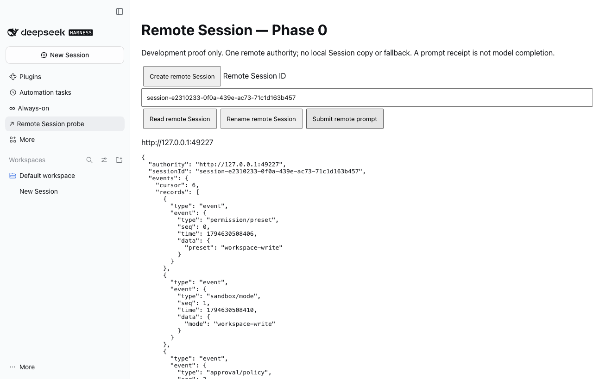

# v0.2 Phase 0 — Native Desktop / remote Session feasibility

Date: 2026-11-14. **GO for the scoped native remote-adapter architecture.** The core Phase 0 feasibility proof passed on actual official macOS ARM64 and Windows x64 applications. **v0.2 is not MVP Ready.** This is a private development probe, not a released native product or hosted service.

## Verified results

Tested source: [3d704a3](https://github.com/abwoo/-DeepSeek-Always-on-Personal-AI-Agent-Plugin/commit/3d704a3a557ab4852f3e2780de3bcaeab7bca68b).

| Check | macOS ARM64 | Windows x64 |
| --- | --- | --- |
| Official signed Desktop app installed and executed | Passed; Apple Developer ID `NAN929V4UM` | Passed; valid DeepSeek Authenticode signature |
| Actual bundled Harness / Cordis | `0.2.2-rc.3` / `4.1.0` | `0.2.2-rc.3` / `4.1.0` |
| Desktop-owned plugin installation and native panel | Passed | Passed |
| UI task creation verified by authenticated Host state read | Passed | Passed |
| Local compatibility task survives actual Desktop process restart | Passed | Passed |
| Native probe creates / renames a real Session on an independent Harness authority | Passed | Passed |
| Native probe submits a real prompt to that same remote Session | Input receipt + durable event verified | Input receipt + durable event verified |
| Independent SDK observer reads the same remote Session ID and input event | Passed | Passed |
| Remote Session readable with Desktop process stopped | Passed | Passed |
| Restarted Desktop reads that same remote ID and history again | Passed | Passed |
| Uninstall both bundles through Desktop-owned command | Passed | Passed |
| Native screenshot capture | Captured and inspected | Initial window captured; two panel captures timed out and remain explicit warnings |
| Real DeepSeek model generation | **Not tested** | **Not tested** |
| Computer power-off / production managed Host | **Not tested** | **Not tested** |
| Native iPhone / Android delivery | **Not tested** | **Not tested** |

The authority and Desktop are **separate actual processes, profiles, data directories and ports on each disposable GitHub cloud runner**. Stopping Desktop does not stop that authority. This proves process/authority separation and remote Session control; it does not prove an Internet deployment or survival of a physical computer shutdown. The local compatibility task is a separate test and must not be presented as a shared v0.2 task.

The Session test uses no model fixture. No provider credential is configured. A prompt receipt is not inference or business completion. Existing core integration tests continue using an explicitly labelled deterministic model fixture; they are not production DeepSeek acceptance.

## Inspectable evidence

- [macOS native run 43556678512](https://github.com/abwoo/-DeepSeek-Always-on-Personal-AI-Agent-Plugin/actions/runs/43556678512): passed.
- [Windows native run 43556678308](https://github.com/abwoo/-DeepSeek-Always-on-Personal-AI-Agent-Plugin/actions/runs/43556678308): passed.
- [Core / Web / protocol run 43556678298](https://github.com/abwoo/-DeepSeek-Always-on-Personal-AI-Agent-Plugin/actions/runs/43556678298): 25 unit/integration checks, 3 real Host/browser/protocol tests, plus an authenticated real two-Host bridge check passed.
- Committed raw summaries: [macOS](evidence/phase0/macos-native.json), [Windows](evidence/phase0/windows-native.json), actual runtime metadata [macOS](evidence/phase0/macos-runtime.json) / [Windows](evidence/phase0/windows-runtime.json).
- Full workflow artifacts include installer signature/version metadata and native observations, retained for 14 days. Windows records the screenshot warnings rather than substituting generated images or claiming visual acceptance.

This diagnostic panel intentionally shows the actual remote authority, opaque Session ID and durable events. It is not the final product UI. It does not switch or relabel the default local Desktop chat.

## Exact compatibility pins

SDK packages `@deepseek-ai/dsh`, `dsh-client-connection`, `dsh-api-gateway`, `dsh-api-session-controller` and `dsh-typert-registry` are pinned to `0.2.2-rc.3`; Cordis is pinned to `4.1.0`. Tests read the installed package versions. Native probes independently read the actual signed application's Cordis metadata and bundled CLI version.

| Official installer | SHA-256 |
| --- | --- |
| Windows x64 | `786c9b26050c35b62c7be6a01dee2541dc1c2c5d9bd5f2dbe77beeeb8d50704e` |
| macOS ARM64 | `65ec0268d77b8e65786d51fd8b89bed13040f0e53e547d15ee2ca2e013ebeb40` |

Installers come from links on [DeepSeek downloads](https://www.deepseek.com/en/download/). The URLs are moving `latest` aliases, so both workflows reject changed hashes before executing an app. A new preview build requires explicit version/hash review and compatibility reruns. Upstream master can drift within a preview version; do not substitute it for the verified npm packages or signed binaries.

## Architecture decision

The [official Desktop reference](https://github.com/deepseek-ai/deepseek-harness/blob/dsh-v0.2.2-rc.3/apps/desktop/README.md) describes a shell around an owned local Host, private main-process credentials and a separate plugin profile. Its renderer uses the Web client plugin platform: `platform: web` remains correct for a native Desktop extension and does not turn a phone website into a native mobile app.

No supported plugin API for replacing Desktop's entire root connection was established. **Use a scoped native panel plus an isolated remote connection**, leaving the local root intact. Never pass a remote ID to local `ctx.uiWorkspace.openSession` and claim the local chat has become remote. The private probe proves real create/read/rename/prompt operations against the remote authority using public exported Connection, Gateway and generated Session APIs. There are no private source imports, Harness core patches, copied Sessions, local fallback inference or second Agent Loop.

In production, one managed Harness owns Session events, native Agent execution, Schedule, Goals, Memory, Inbox and Run Ledger. Desktop's local Host is only an extension/device bridge for that Personal Agent. Local files and actions need expiring online capabilities and native permission/approval enforcement; they are not implemented by this probe.

`src/remote/probe-connection.ts` uses the official GET `/connect?token=…&interactions=none` exchange and API lifecycle socket. The test launch token is operator-level and remains in server process memory/environment, never in the renderer or phone. Passive clients cannot answer approvals. HTTPS is required except explicitly enabled loopback tests; HTTP and WS cannot change authority. A failed connection never falls back to a local Session.

**This is not production device authentication.** Before shipping, replace operator test-token pairing with scoped, revocable device credentials at an authenticated gateway, implement renewal/reconnect and durable mutation reconciliation, and keep DeepSeek model keys solely on the managed authority.

## Reproduction and interface lessons

`npm ci`, `npm run check`, and the core workflow exercise the preserved core. Install the disposable Web bundle and run `npm run test:e2e` for native Harness Web/protocol checks. The workflow additionally builds/packs the private probe and runs `scripts/probe-remote-bridge.mjs` against two real Hosts, including unauthenticated rejection. Native workflows install the pinned signed application, build the separate [private package](../probes/desktop-remote/README.md), and run `scripts/probe-native-desktop.mjs` on each OS.

Two real-interface assumptions were corrected: `SessionId` is an opaque branded string (current IDs have a `session-` prefix), not a UUID; and the published CLI consumes `--patch` before forwarded Web runner arguments. These are now exercised by actual Host launches and adapter operations. The global npm CLI explicitly rejects Desktop profile management; use the actual application's command after profile initialization and while the app is quit. No artificial Desktop profile was created to bypass ownership.

The private package is never installed by the shipping bundle, its helpers are excluded from the public tarball, and its tarball is excluded from alpha release assets. Current public release remains the v0.1 Web alpha.

## Remaining gates

Phase 1 can now implement the product Desktop remote panel and typed connection lifecycle using this verified architecture. Full chat rendering/stream recovery, scoped pairing and product UX still need implementation; the diagnostic event viewer is not a completed Phase 1 interface. Native disable/re-enable behavior and Windows visual QA need explicit release coverage beyond the current restart/uninstall and core lifecycle checks.

Phase 2 production acceptance requires an operator-authorized managed compute/storage service, identity/TLS configuration, billing limits and a server-side DeepSeek provider credential. None has been provisioned here. GitHub Actions is a test runner, not a 24-hour Personal Agent host. End users must not be asked to maintain a VPS.

Native Expo app builds, Apple signing/provisioning, Expo/APNs/FCM configuration, real iPhone/Android tests, physical desktop power-off and the complete shared-task/real-model/native-push chain remain unverified. No mock, screenshot, queued input or CI fixture may fill these rows. **MVP Ready stays false.**
