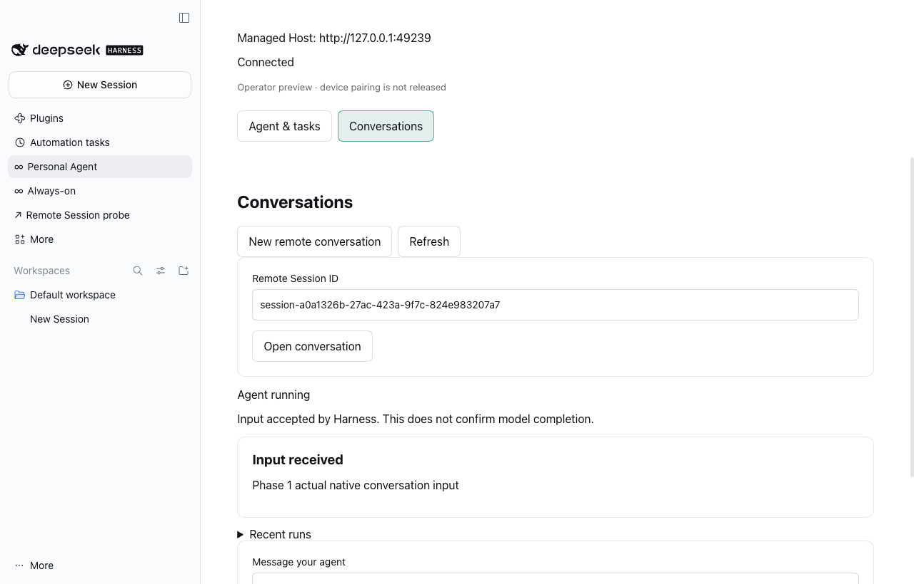

# v0.2 Phase 1 — Desktop remote package

Status: native shared-state foundation accepted on official macOS ARM64 and Windows x64 applications. Production pairing and the full conversation interface remain open. Not a production release.

## Scope

- Added separate `@abwoo/deepseek-always-on-desktop@0.2.0-dev.1` package with a native Personal Agent entry, connection authority/status and remote conversations.
- Extracted the existing task, memory and Inbox panel into a shared component. Web retains its existing endpoint; Desktop supplies the remote bridge endpoint. The scheduling, consent, storage, notification and Run Ledger implementations are reused unchanged.
- Remote task/memory/Inbox operations use the authority's original API with the same durable identifiers. Execution-session links select the remote reader rather than Desktop's local chat.
- Session create/read/prompt/cancel use official generated APIs in an isolated Context. Queued input remains distinct from model success. Human approval is never answered by this passive transport.
- Offline reads retain last confirmed data with an explicit stale label. Writes require an established remote connection; read calls can reconnect. Mutations are never automatically replayed or redirected to the local Host. Unknown outcomes require review rather than a success claim.
- Plugin disposal closes its owned SDK context/socket; it does not stop the managed authority's Agent or schedulers. The managed Always-on core's own disable behavior remains responsible for pausing its background tasks.

## Evidence and tests

`scripts/probe-remote-bridge.mjs` installs the packed Desktop package and existing probe into a disposable real proxy Host, then connects to a second actual Harness process. It verifies authenticated task/memory writes through the Desktop bridge by independently reading the authority, rejects unapproved API actions and confirms real authority shutdown causes HTTP 503 / write refusal. No model fixture supplies these outcomes.

The existing 25 unit/native integration checks pass, plus one presentation regression for durable input receipts. Their model fixture remains explicitly labelled. Official macOS ARM64 / Windows workflows now additionally install the Desktop package, create a shared task and consented memory through its actual UI, verify the authority independently, submit a real remote Session input and re-read the same remote task after Desktop restart. The native runs passed against source [928a4ae](https://github.com/abwoo/-DeepSeek-Always-on-Personal-AI-Agent-Plugin/commit/928a4ae74a1fc59dfd93e6b1f9d96b5f4b63fd21):

| Evidence | Result |
| --- | --- |
| [macOS native](https://github.com/abwoo/-DeepSeek-Always-on-Personal-AI-Agent-Plugin/actions/runs/43566248296) | Shared task, consented memory, Session input, same remote task ID after Desktop restart: passed |
| [Windows native](https://github.com/abwoo/-DeepSeek-Always-on-Personal-AI-Agent-Plugin/actions/runs/43566248324) | Same functional checks: passed; legacy diagnostic screenshots retain explicit capture warnings |
| [Core / Web / bridge](https://github.com/abwoo/-DeepSeek-Always-on-Personal-AI-Agent-Plugin/actions/runs/43566248334) | 26 unit/integration, 3 browser/protocol, real remote writes and offline write refusal: passed |

Raw summaries are retained in [macOS JSON](evidence/phase1/macos-native.json) and [Windows JSON](evidence/phase1/windows-native.json). Each run uses two real processes/profiles on its own disposable cloud runner, not a production Internet deployment or a physical power-off test. The receipt and running state come from actual Harness events; no model output is fabricated.

Native UI assertions additionally verify that the connection indicator shows the successful connection and that the accepted input is actually visible. The viewer distinguishes durable input receipts from user messages already consumed by the model, and removes the duplicate receipt when the corresponding message enters model history.

The public alpha release artifact excludes both the private Phase 0 probe and the Phase 1 preview package. The v0.1 release version is not promoted to v0.2 based on these checks.

## Remaining work

The package is an operator development preview with Host-side launch-token bootstrap. Production device pairing, scoped identity, renewal, provider execution and persistent managed deployment require Phase 2. Recent text messages/native status are supported; complete attachments, streamed rendering, native approval interactions and history pagination are not yet accepted. Full mutation deduplication/reconciliation belongs to the shared-state gate and remains open.

No real DeepSeek generation, computer power-off production chain, native Expo device build or APNs/FCM receipt is certified here. Apple signing, real devices and an operator-authorized managed service/provider credential remain prerequisites. **MVP Ready is false.**
